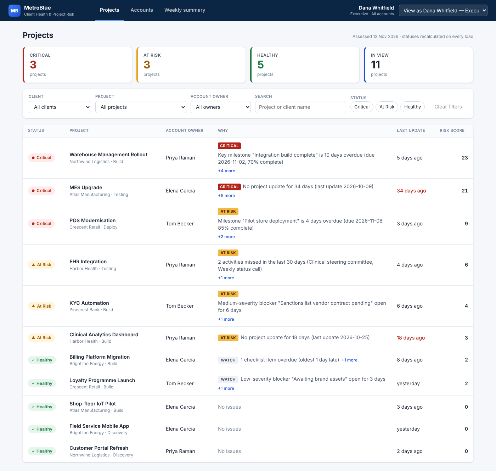

# MetroBlue · Client Health and Project Risk Monitor

An internal service that assesses every active project and flags the accounts and projects that
need attention before deadlines are missed.

- Calculates a **Healthy / At Risk / Critical** status for each project from seven indicators:
  - overdue milestones
  - overdue checklist items
  - unresolved blockers
  - missed activities
  - rescheduled activities
  - upcoming deadlines
  - time since the last update
- Shows the **reasons** behind every status, most severe first.
- Rolls project health up to **account (client) health**.
- Filters by **client, project, status and account owner**, plus free-text search. Filters are
  kept in the URL, so a filtered view can be shared as a link.
- Produces a **weekly management summary** that can be:
  - viewed in the app
  - exported as CSV, Markdown or email-ready HTML
  - delivered automatically every Monday through an outbox folder and an optional webhook
    (Teams, Slack or a mail relay)
- Respects **existing permissions**:
  - Users see only the projects they're already entitled to.
  - Contract values are hidden from roles without financial access.
  - The weekly summary is limited to managers.

The calculation rules are documented in **[docs/CALCULATION_RULES.md](docs/CALCULATION_RULES.md)**.



More screenshots: [project detail](docs/screenshots/project-detail.png) · [accounts](docs/screenshots/accounts.png) · [weekly summary](docs/screenshots/weekly-summary.png)

---

## Quick start

**Requires Node.js 22 or later.** The server has no runtime dependencies. The client uses React 19
and is bundled with esbuild.

```bash
npm install          # installs both workspaces (server + client)
npm start            # builds the frontend, then serves app + API on http://localhost:4000
```

Open <http://localhost:4000>. The app runs in **demo mode** with realistic sample data, and its
dates are always relative to today. Use the **"View as…"** menu in the top-right corner to
switch between demo users and see how permissions change what each one can see:

| Demo user      | Role             | Sees                                      | Weekly summary | Contract values |
| -------------- | ---------------- | ----------------------------------------- | :------------: | :-------------: |
| Dana Whitfield | Executive        | All 6 clients / 11 projects               | ✓              | ✓               |
| Marcus Lee     | Delivery manager | His team's accounts (Priya's + Tom's)     | ✓              | ✓               |
| Priya Raman    | Account owner    | Northwind Logistics, Harbor Health        | —              | ✓               |
| Tom Becker     | Account owner    | Crescent Retail, Pinecrest Bank           | —              | ✓               |
| Elena García   | Account owner    | Atlas Manufacturing, Brightline Energy    | —              | ✓               |
| Sam Okafor     | Project manager  | Only projects he manages                  | —              | —               |

### Development

```bash
npm run dev          # esbuild watch (client) + node --watch (server), on http://localhost:4000
```

Reload the browser after editing client code. The server restarts automatically when its code changes.

### Tests

```bash
npm test             # server (node:test) + client (node:test + react-dom/server)
```

| Suite                                  | Covers                                                                    |
| -------------------------------------- | ------------------------------------------------------------------------- |
| `server/test/health.test.js`           | Every rule's thresholds and boundaries, status roll-up, score, account roll-up |
| `server/test/permissions.test.js`      | Role scopes, explicit grants, detail access, field redaction, export rights |
| `server/test/summary.test.js`          | Weekly summary maths, movement, CSV/Markdown/HTML output and escaping, delivery, scheduler |
| `server/test/api.test.js`              | HTTP API end to end: auth, every filter, scoping, 404 on out-of-scope, exports, SSO header mode |
| `client/test/query.test.jsx`           | URL ↔ filter state, formatting helpers                                    |
| `client/test/components.test.jsx`      | Rendering of badges, reasons, table, tiles, accounts and summary          |

---

## Weekly summary and notifications

The weekly summary is generated separately for each recipient and limited to that recipient's
own accounts.

| How                       | What happens                                                                       |
| ------------------------- | ---------------------------------------------------------------------------------- |
| **In the app**            | **Weekly summary** tab: preview, then **Export CSV**, **Markdown**, **Email HTML**, or **Send to me now** |
| **Automatically**         | Every Monday from 08:00 server time, the server sends a summary to each user with the `export_summary` permission and saves that week's status snapshot. Restarts don't trigger a second send. |
| **From a scheduler / CLI**| `npm run summary` delivers to all recipients. `npm run summary -- --user u-dm1 --format csv` prints one user's summary instead. |

Each delivery writes `server/var/outbox/<week>/<userId>.html` (an email body) and `.md`. If
`SUMMARY_WEBHOOK_URL` is set, it also POSTs this payload to that URL:

```json
{ "subject": "Weekly delivery health — week of 2026-11-09", "to": "marcus.lee@metroblue.example", "text": "<markdown>", "totals": { ... } }
```

Point the webhook at a Teams or Slack incoming-webhook adapter, or at a small mail relay.

---

## Configuration

All settings are environment variables. All are optional.

| Variable               | Default            | Purpose                                                                  |
| ---------------------- | ------------------ | ------------------------------------------------------------------------ |
| `PORT`                 | `4000`             | HTTP port                                                                |
| `AUTH_MODE`            | `dev`              | `dev` = demo tokens + user switcher; `header` = trust SSO proxy header (see below) |
| `DATA_FILE`            | *(demo data)*      | Path to a JSON export of MetroBlue project data (see [Data model](#data-model)) |
| `HEALTH_RULES_FILE`    | —                  | JSON file of threshold overrides, deep-merged over the defaults          |
| `SUMMARY_SCHEDULE`     | on                 | `off` disables the in-process weekly scheduler                           |
| `SUMMARY_DAY`          | `1` (Monday)       | 0 = Sunday … 6 = Saturday                                                |
| `SUMMARY_HOUR`         | `8`                | Local server hour at or after which the weekly run fires                 |
| `SUMMARY_WEBHOOK_URL`  | —                  | Where to POST each summary                                               |
| `VAR_DIR`              | `server/var`       | Snapshots, scheduler state and outbox                                    |
| `AS_OF`                | today              | Freeze "today" (`YYYY-MM-DD`). Useful for demos and reproducing an assessment |

---

## Permissions

The monitor **never widens access**. Permission checks run in one place
(`server/src/app.js` → `server/src/auth/permissions.js`), and every API response, export and
notification goes through them.

| Role               | Project visibility                                            | Capabilities                         |
| ------------------ | ------------------------------------------------------------- | ------------------------------------ |
| `executive`        | All projects                                                  | `view_financials`, `export_summary`  |
| `delivery_manager` | Clients owned by themselves or anyone in their `teamMemberIds` | `view_financials`, `export_summary`  |
| `account_owner`    | Clients where they are the account owner                      | `view_financials`                    |
| `project_manager`  | Projects they manage or are a member of                       | —                                    |

Any user can also receive extra access through `clientIds` or `projectIds` grants.

Requests for a project outside the user's scope return **404, not 403**, so users can't confirm
that the project exists. Filter options such as the client and owner dropdowns list only values
within the user's scope.

**Using MetroBlue's real entitlements:** replace `resolveScope(user, repo)` with a call to the
existing permission service. It must return `{ all, projectIds, permissions, label }`. Nothing
else needs to change.

### Authentication

- **`AUTH_MODE=dev`** (default): uses bearer tokens from the dataset and enables the "View as"
  switcher. **Not for production.**
- **`AUTH_MODE=header`**: deploy behind MetroBlue's SSO reverse proxy (for example oauth2-proxy,
  Azure App Proxy or an API gateway). The proxy authenticates the user and sets
  `X-Authenticated-Email`, which the server matches against user emails. The dev endpoints and
  the switcher are disabled. Make sure the proxy **strips this header from incoming client
  requests**.

---

## Data model

The monitor works without MetroBlue's source code. It needs only a read-only feed of project
data in this shape. Supply it with `DATA_FILE=/path/export.json`, or replace `loadDataset()` in
`server/src/data/repository.js` with an adapter over the project system's API or database.

```jsonc
{
  "users":          [{ "id", "name", "email", "role", "title", "teamMemberIds?", "clientIds?", "projectIds?" }],
  "clients":        [{ "id", "name", "accountOwnerId", "region", "tier" }],
  "projects":       [{ "id", "clientId", "name", "projectManagerId", "memberIds", "phase", "startDate", "endDate", "contractValue", "lastUpdateAt?", "closed?" }],
  "milestones":     [{ "id", "projectId", "name", "dueDate", "progress", "isKey", "completedAt" }],
  "checklistItems": [{ "id", "projectId", "title", "dueDate", "done" }],
  "blockers":       [{ "id", "projectId", "title", "severity": "low|medium|high", "raisedAt", "resolvedAt", "ownerName" }],
  "activities":     [{ "id", "projectId", "type", "title", "scheduledFor", "status": "scheduled|completed|missed|cancelled", "rescheduleCount", "lastRescheduledAt" }],
  "updates":        [{ "id", "projectId", "authorId", "postedAt", "summary" }]
}
```

Dates are ISO 8601 strings (`2026-11-12` or `2026-11-12T15:00:00Z`).

---

## API

All endpoints except `/api/health` require authentication. Responses are JSON unless stated otherwise.

| Method | Path                                | Description                                                          |
| ------ | ----------------------------------- | -------------------------------------------------------------------- |
| GET    | `/api/health`                       | Liveness check                                                       |
| GET    | `/api/me`                           | Current user, role, scope and permissions                            |
| GET    | `/api/meta`                         | Filter options (clients, owners, projects) within the user's scope   |
| GET    | `/api/projects`                     | Assessed projects, most severe first. Query: `clientId`, `projectId`, `ownerId`, `q`, `status` (comma list or repeated) |
| GET    | `/api/projects/:id`                 | One project with reasons, milestones, blockers, checklist, activities and updates |
| GET    | `/api/clients`                      | Account roll-ups. Takes the same filters as `/api/projects`          |
| GET    | `/api/summary/weekly`               | Weekly summary. `format=json\|csv\|md\|html`; add `download=1` to download as a file. Requires `export_summary` |
| POST   | `/api/summary/weekly/send`          | Deliver the summary to the caller now. Requires `export_summary`     |

---

## Project structure

```
metroblue-health-monitor/
├── server/                     Node.js API (no runtime dependencies)
│   ├── src/
│   │   ├── config/rules.js     ← all thresholds
│   │   ├── engine/health.js    ← rules R1–R7, status roll-up, account roll-up
│   │   ├── auth/permissions.js ← scopes, capabilities, redaction
│   │   ├── data/               repository + demo seed (swap for MetroBlue adapter)
│   │   ├── services/           filters, weekly summary + exports, snapshots, notifications/scheduler
│   │   ├── http/server.js      routes, auth, static hosting of the built client
│   │   ├── cli/weekly-summary.js
│   │   ├── app.js              wiring; single place permissions are enforced
│   │   └── index.js            entry point
│   └── test/
├── client/                     React 19 single-page app (bundled with esbuild)
│   ├── src/  App.jsx, api.js, components/, lib/, styles.css
│   └── test/
├── docs/CALCULATION_RULES.md
└── scripts/dev.mjs
```

## Production notes

- Run `npm run build`, then run `node server/src/index.js` under a process manager (systemd,
  PM2 or a container) with `AUTH_MODE=header` behind the SSO proxy.
- Keep `VAR_DIR` on persistent storage so snapshots and scheduler state survive redeploys.
- If you run several instances, set `SUMMARY_SCHEDULE=off` on all of them and trigger
  `npm run summary` from one external scheduler. This avoids duplicate sends.
